# Monitoring, Logging & Observability

A complete monitoring stack built on a Linux server, instrumented with Node Exporter, scraped by Prometheus, visualised in Grafana, and wired to an alert that fires on sustained high CPU. The repository also documents a full incident walkthrough: generate load, detect it in metrics, confirm it in logs, identify the cause, and restore normal operation.

Week 8 deliverable of the Davine Technologies DevOps Internship.

---

## Table of Contents

- [Overview](#overview)
- [Monitoring Architecture](#monitoring-architecture)
- [Technology Stack](#technology-stack)
- [Repository Structure](#repository-structure)
- [1. Environment Setup](#1-environment-setup)
- [2. Prometheus](#2-prometheus)
- [3. Node Exporter](#3-node-exporter)
- [4. Grafana](#4-grafana)
- [5. Metrics Monitored](#5-metrics-monitored)
- [6. Linux Logs](#6-linux-logs)
- [7. ELK Stack Overview](#7-elk-stack-overview)
- [8. Alerting](#8-alerting)
- [9. Incident Walkthrough](#9-incident-walkthrough)
- [10. Troubleshooting Summary](#10-troubleshooting-summary)
- [Key Takeaways](#key-takeaways)
- [Roadmap](#roadmap)
- [Reproducing This Lab](#reproducing-this-lab)
- [Report](#report)
- [Author](#author)
- [License](#license)

---

## Overview

Monitoring answers **what** a system is doing. Logging answers **why** it did it. Observability is the property of a system that lets you ask both questions without shipping new code to find the answer.

This lab builds that capability end to end on a single Ubuntu host:

| Goal | How it was met |
|---|---|
| Collect host metrics | Node Exporter on port 9100 |
| Store and query metrics | Prometheus on port 9090, scraping every 15s |
| Visualise metrics | Grafana on port 3000, Node Exporter Full dashboard (ID 1860) |
| Detect abnormal behaviour | Grafana managed alert rule, CPU above 80% |
| Investigate causes | `journalctl`, `/var/log/syslog`, `/var/log/auth.log`, `top` |
| Prove the pipeline works | Controlled CPU spike with `stress`, observed end to end |

Every claim in this README is backed by a numbered screenshot in [`Screenshots/`](./Screenshots). File names follow `NN-phase-description.png`, so the evidence sorts into the order the work actually happened.

---

## Monitoring Architecture


Each hop has a single responsibility:

1. **Node Exporter** reads `/proc` and `/sys` on the host and renders them as Prometheus text format on `:9100/metrics`. It stores nothing.
2. **Prometheus** pulls that endpoint on a schedule and writes the samples into its local time series database. It is the system of record for metrics.
3. **Grafana** never touches the host. It queries Prometheus with PromQL and draws the result.
4. **Grafana alerting** evaluates the same PromQL on a timer and changes rule state when the result breaches a threshold.

The pull model matters: if Prometheus cannot reach a target, the target goes `down` and that absence is itself a signal.

---

## Technology Stack

| Layer | Component | Version / detail |
|---|---|---|
| Host | Windows 11, VirtualBox, Vagrant | Host machine `ZINOX` |
| Guest OS | Ubuntu (`ubuntu-bionic` hostname) | Kernel `7.0.0-38-generic` |
| Metrics exporter | Prometheus Node Exporter | Port 9100 |
| Metrics server | Prometheus | Port 9090 |
| Visualisation | Grafana OSS | 13.2.3, port 3000 |
| Dashboard | Node Exporter Full | Grafana dashboard ID 1860 |
| Load generator | `stress` | 2 CPU workers |
| Log tooling | `journalctl`, `tail`, `grep` | systemd journal and `/var/log` |

---

## Repository Structure

```
.
├── Vagrantfile                 # VM definition: memory, CPUs, forwarded ports, boot timeout
├── config/
│   ├── prometheus.yml          # Scrape configuration for both jobs
│   └── alert-rules/
│       └── high-cpu-usage.md   # The Grafana managed alert rule, documented for recreation
├── docs/
│   └── Week8-Monitoring-Logging-Observability-Report.pdf
├── Screenshots/                # 42 numbered evidence captures
├── .gitignore
├── LICENSE
└── README.md
```

---

## 1. Environment Setup

The lab runs inside a Vagrant managed VirtualBox VM. The [`Vagrantfile`](./Vagrantfile) forwards every port the stack needs so each service is reachable from the host browser at `http://localhost:<port>`.

```ruby
config.vm.boot_timeout = 900                                   # slow host, generous boot window
config.vm.network "forwarded_port", guest: 8080,  host: 8080   # Jenkins
config.vm.network "forwarded_port", guest: 30080, host: 30080  # Kubernetes NodePort
config.vm.network "forwarded_port", guest: 9090,  host: 9090   # Prometheus
config.vm.network "forwarded_port", guest: 9100,  host: 9100   # Node Exporter
config.vm.network "forwarded_port", guest: 3000,  host: 3000   # Grafana

config.vm.provider "virtualbox" do |vb|
  vb.memory = "4096"
  vb.cpus = 1
end
```

Two settings are the direct result of problems hit during the build, documented in [section 10](#10-troubleshooting-summary):

- `boot_timeout = 900` because the VM needed roughly 13 minutes to boot on a contended host and Vagrant's default wait gave up first.
- `vb.cpus = 1` after a 2 vCPU guest was repeatedly starved by the Windows host, producing kernel RCU stall warnings and wildly distorted wall clock timings.

Bring the environment up with:

```bash
vagrant up          # or: vagrant reload, after editing the Vagrantfile
vagrant ssh
```

---

## 2. Prometheus

Prometheus runs as a systemd unit and is enabled at boot.

```bash
sudo systemctl enable --now prometheus
sudo systemctl status prometheus --no-pager
```

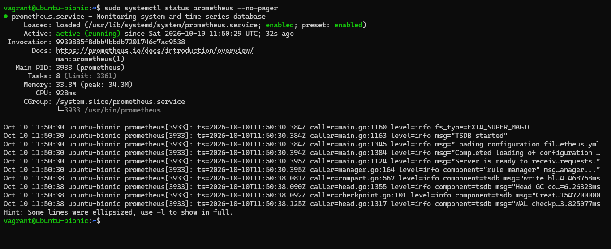

The service log confirms the clean startup sequence: WAL replay, `TSDB started`, configuration loaded, `Server is ready to receive web requests`.

### Scrape configuration

[`config/prometheus.yml`](./config/prometheus.yml) defines two jobs. The second is named `node_exporter` rather than the more common `node` so that the job label is self describing everywhere it surfaces: in the targets API, in Grafana template variables, and in alert labels.

```yaml
scrape_configs:
  - job_name: "prometheus"
    scrape_interval: 5s
    static_configs:
      - targets: ["localhost:9090"]

  - job_name: "node_exporter"
    static_configs:
      - targets: ["localhost:9100"]
```

Always validate before restarting. A malformed file leaves Prometheus refusing to start, and the lost scrapes are a gap in the record that cannot be backfilled:

```bash
promtool check config /etc/prometheus/prometheus.yml
sudo systemctl restart prometheus
```

### Verifying targets

The targets API is the authoritative answer to "is Prometheus actually collecting anything".

```bash
curl -s http://localhost:9090/api/v1/targets \
  | grep -o '"job":"[^"]*"\|"scrapeUrl":"[^"]*"\|"health":"[^"]*"'
```

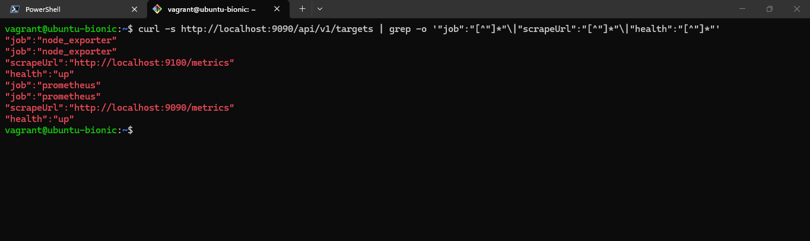

Both jobs report `"health":"up"`. Anything else, and no dashboard downstream can be trusted.

---

## 3. Node Exporter

Node Exporter is the collection agent. It exposes host level metrics on port 9100 and holds no state of its own, which makes it safe to restart at any time.

```bash
curl -s http://localhost:9100/metrics | head -20
systemctl is-active node_exporter
```

Its `scrapeUrl` of `http://localhost:9100/metrics` appears in the targets output above, which is the proof that Prometheus is reaching it successfully.

---

## 4. Grafana

### Installation from the official repository

```bash
sudo apt-get install -y apt-transport-https software-properties-common wget gnupg
sudo install -m 0755 -d /etc/apt/keyrings
wget -q -O - https://apt.grafana.com/gpg.key | sudo gpg --dearmor --yes -o /etc/apt/keyrings/grafana.gpg
echo "deb [signed-by=/etc/apt/keyrings/grafana.gpg] https://apt.grafana.com stable main" \
  | sudo tee /etc/apt/sources.list.d/grafana.list
sudo apt-get update && sudo apt-get install -y grafana
sudo systemctl enable --now grafana-server
```

The `signed-by` form pins the repository to one specific key rather than trusting it globally, which is the current recommended practice for third party APT sources.

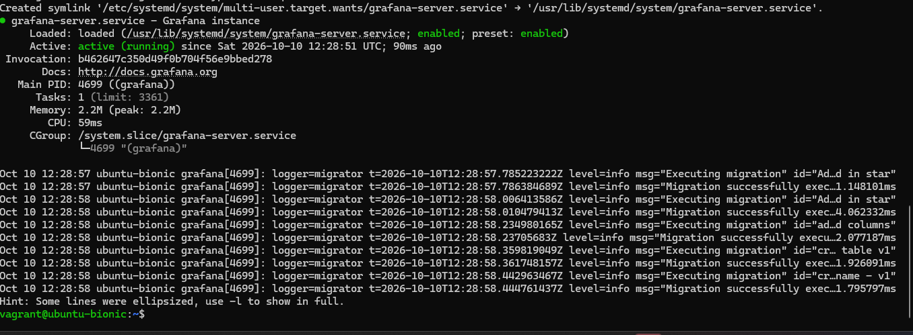

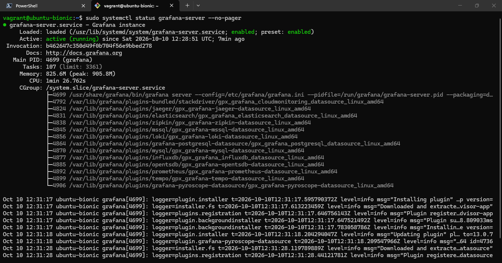

### Health check

Grafana takes time to run its database migrations and register bundled plugins on first start, so a health check is more reliable than assuming the port is ready:

```bash
curl -s http://localhost:3000/api/health
```

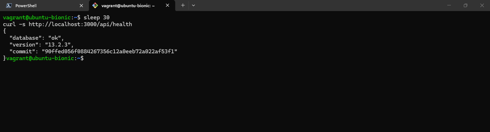

A `"database": "ok"` response means Grafana is genuinely ready, not merely listening.

### Data source and dashboard

1. Sign in at `http://localhost:3000` (default `admin` / `admin`, changed on first login).
2. **Connections**, **Data sources**, **Add new data source**, **Prometheus**.
3. Set the URL to `http://localhost:9090`, then **Save & test**.
4. **Dashboards**, **New**, **Import**, enter dashboard ID **1860** (Node Exporter Full), select the `prometheus` data source, **Import**.

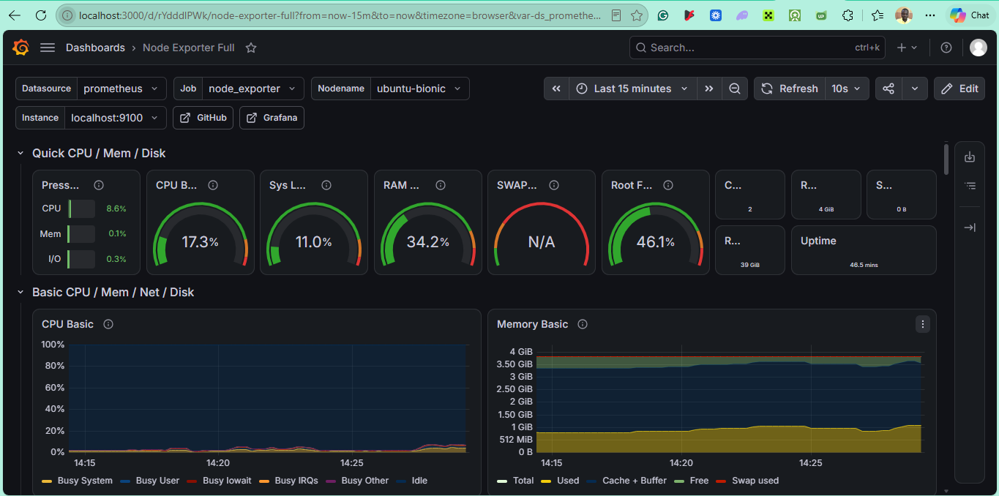

This is the baseline. CPU busy at 17.3%, RAM at 34.2%, root filesystem at 46.1%, uptime 48.5 minutes. Knowing what normal looks like is what makes abnormal recognisable later.

---

## 5. Metrics Monitored

The weekly task calls for CPU, memory, disk and uptime. Each is a PromQL expression over the raw counters and gauges that Node Exporter publishes.

| Metric | PromQL |
|---|---|
| CPU usage (%) | `100 - (avg by(instance) (rate(node_cpu_seconds_total{mode="idle"}[1m])) * 100)` |
| Memory usage (%) | `(1 - node_memory_MemAvailable_bytes / node_memory_MemTotal_bytes) * 100` |
| Disk usage (%) | `100 - (node_filesystem_avail_bytes{mountpoint="/"} / node_filesystem_size_bytes{mountpoint="/"} * 100)` |
| System uptime | `time() - node_boot_time_seconds` |

Two details worth internalising:

- **CPU is derived, not measured.** `node_cpu_seconds_total` is a monotonic counter of seconds spent per mode per core. `rate()` turns it into a per second rate, `avg by(instance)` collapses the cores, and subtracting idle from 100 yields busy percentage.
- **Use `MemAvailable`, not `MemFree`.** Linux deliberately fills unused RAM with page cache, so `MemFree` looks alarming on a perfectly healthy machine. `MemAvailable` is the kernel's own estimate of what a new workload could actually claim.

The Node Exporter Full dashboard renders these and considerably more:

| CPU and memory | Filesystem |
|---|---|
| 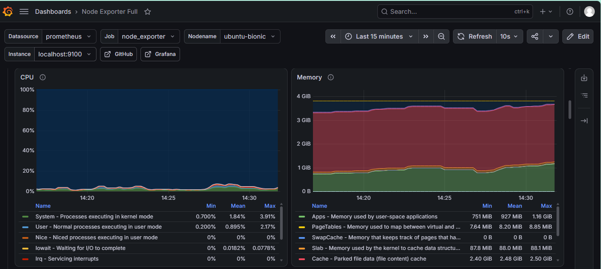 | 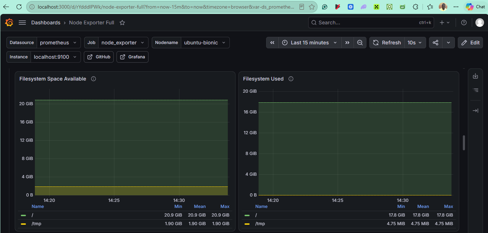 |

| Network throughput and saturation | Disk IOPS and throughput |
|---|---|
| 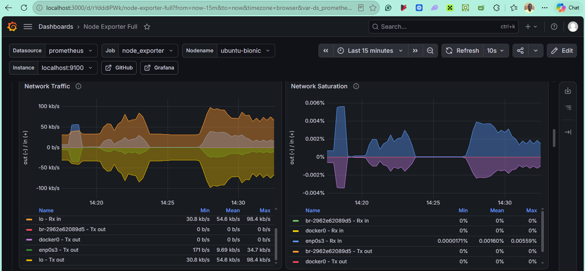 | 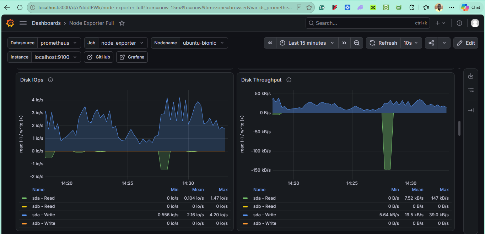 |

Pressure Stall Information is the panel most worth learning. It reports how long tasks were *stalled* waiting on CPU, memory or I/O, which catches contention that plain utilisation percentages hide:

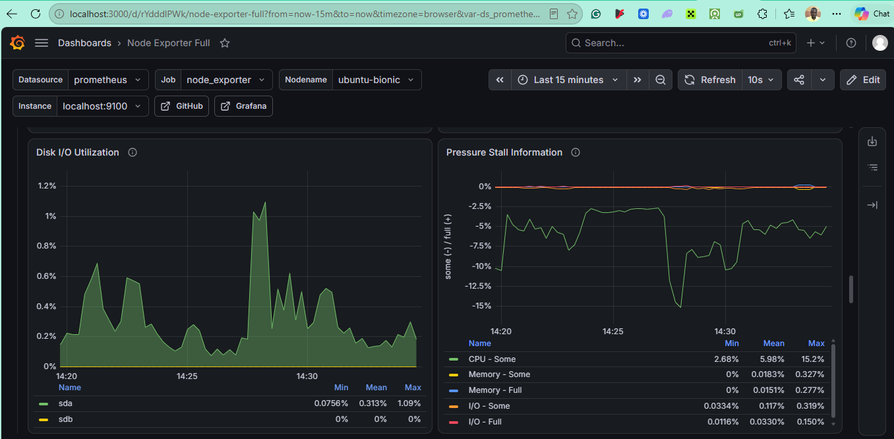

---

## 6. Linux Logs

Metrics show that something changed. Logs show what changed.

| Source | What it holds |
|---|---|
| `/var/log/syslog` | General system messages and service activity |
| `/var/log/auth.log` | Logins, `sudo` invocations, SSH authentication |
| `/var/log/kern.log`, `dmesg` | Kernel messages, hardware events, scheduler warnings |
| `journalctl -u <service>` | Per service logs from systemd, for example `prometheus` or `grafana-server` |

```bash
sudo tail -n 20 /var/log/syslog
sudo tail -n 10 /var/log/auth.log
sudo journalctl -u grafana-server --since "15 min ago" --no-pager
```

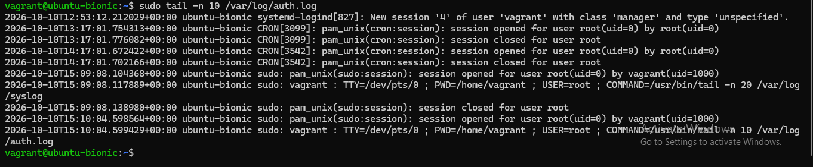

`auth.log` records every privilege escalation with the exact command that was run. It is the first file to read when asking "who changed this host, and when".

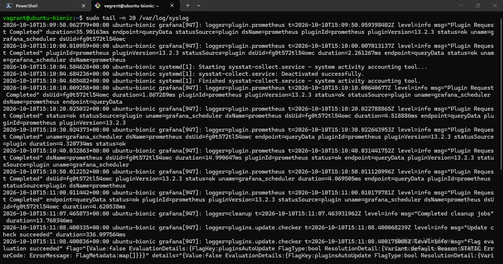

`syslog` here shows Grafana's scheduler issuing `queryData` calls to the Prometheus data source every 10 seconds, which is the alert rule evaluating on its interval. The monitoring stack is visible in the logs of the machine it monitors.

---

## 7. ELK Stack Overview

Prometheus and Grafana handle numeric time series. They are deliberately poor at text. The ELK stack is the complementary half of observability, built for searching log content at scale.

| Component | Purpose |
|---|---|
| **Elasticsearch** | Distributed search and analytics engine. Stores and indexes log documents so they can be queried in near real time. |
| **Logstash** | Server side ingestion pipeline. Collects logs from many sources, parses and enriches them (grok, timestamps, geo lookups), then ships them onward. Lightweight Beats agents such as Filebeat often replace it for simple shipping. |
| **Kibana** | Web interface over Elasticsearch. Free text search, structured filtering, visualisations and dashboards. |

The usual flow is `Filebeat or Logstash` to `Elasticsearch` to `Kibana`.

**How the two stacks divide the work:**

| Question | Tool |
|---|---|
| Is anything wrong right now? | Prometheus and Grafana |
| When did it start, and how bad is it? | Prometheus and Grafana |
| What exactly happened at that moment? | ELK |
| Which user or request triggered it? | ELK |

In practice you alert on metrics because they are cheap and numeric, then pivot into logs for the narrative. The incident in [section 9](#9-incident-walkthrough) follows exactly that pattern, using `journalctl` and `/var/log` in place of Kibana.

> ELK was studied at overview level for this week and was not deployed on this VM. The investigation used the systemd journal and `/var/log` directly.

---

## 8. Alerting

A dashboard only helps when somebody is looking at it. An alert is what turns monitoring into something that works unattended.

Grafana stores managed alert rules in its own database rather than in a file on disk, so [`config/alert-rules/high-cpu-usage.md`](./config/alert-rules/high-cpu-usage.md) documents the rule in full for recreation.

| Setting | Value |
|---|---|
| Rule name | `High CPU Usage` |
| Folder | `Linux Servers` |
| Evaluation group | `cpu`, every `10s` |
| Pending period | `30s` |
| Query A | `100 - (avg by(instance) (rate(node_cpu_seconds_total{mode="idle"}[1m])) * 100)` |
| Condition C | Threshold, `A` **is above** `80` |

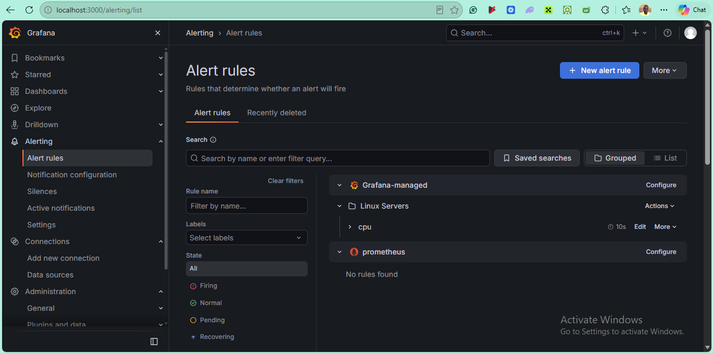

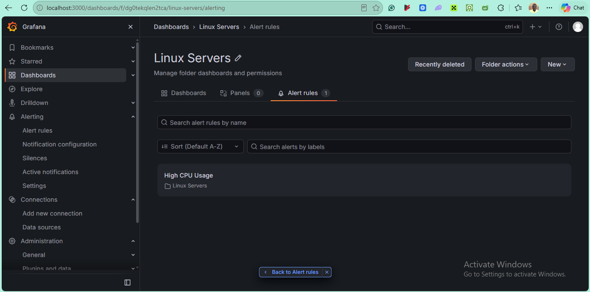

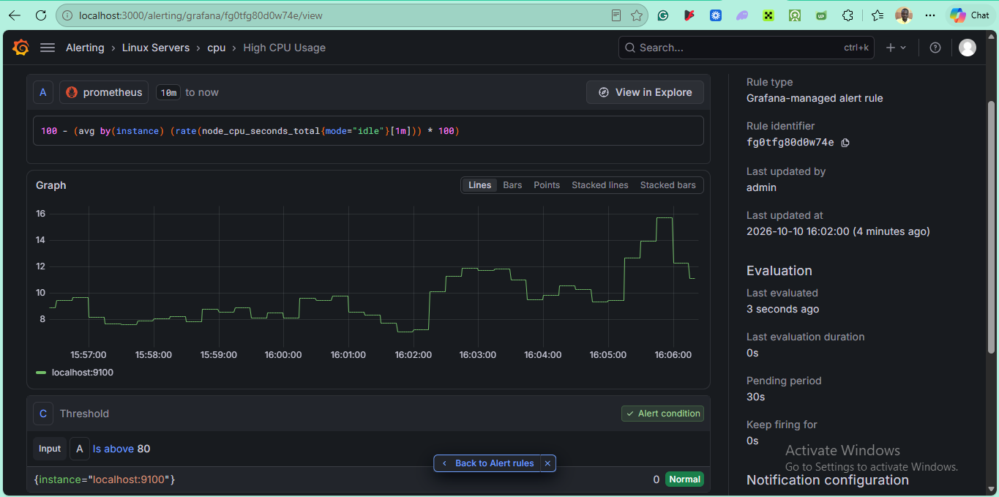

The **pending period** is what separates a useful alert from a noisy one. Without it, a single momentary spike pages somebody at 03:00. With `30s`, the condition must hold across roughly three consecutive evaluations before the rule moves from `Pending` to `Firing`. Combined with the one minute `rate` window, this rule needs a sustained load of around two minutes to trip, which is intentional.

---

## 9. Incident Walkthrough

> **Scenario.** You are the DevOps engineer responsible for a Linux server running a web application. Generate a controlled increase in CPU usage, observe it through the monitoring stack, identify the cause, and restore normal operation.

### Step 1: Baseline

Normal operation, captured before any load was applied. CPU busy 17.3%, RAM 34.2%.


### Step 2: Generate load

```bash
stress --cpu 2 --timeout 900 &
sleep 30
top -b -n 1 | head -15
```

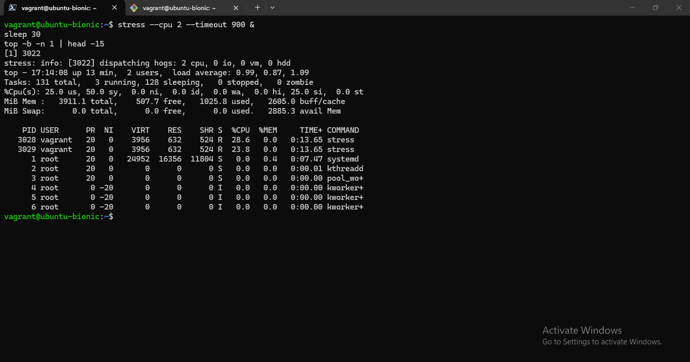

Two `stress` workers in state `R` (runnable) sit at the top of the process table, and the CPU summary line reads `0.0 id`. There is no idle time left.

### Step 3: Observe in Prometheus and Grafana

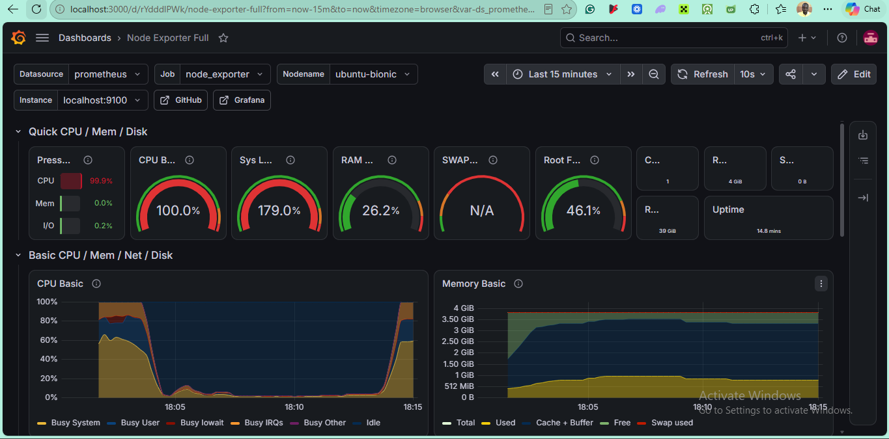

CPU Busy pins at 100%. System load climbs to 179%, meaning more runnable work exists than there are cores to run it. The CPU Basic panel shows the shape clearly: a flat idle baseline, then a sharp step to saturation.

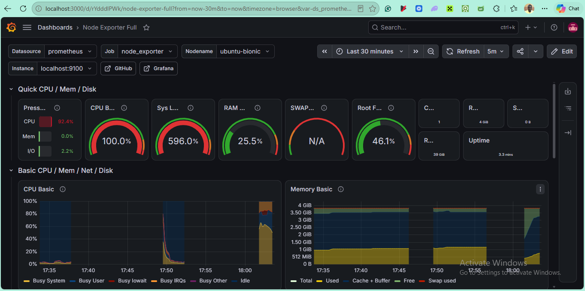

Widening the window to 30 minutes puts the spike in context against the quiet period that preceded it.

### Step 4: The alert fires

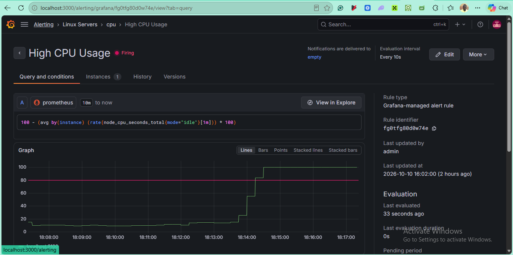

The green series crosses the red threshold line at 80 and stays above it. After the pending period elapses, the rule transitions to `Firing`.

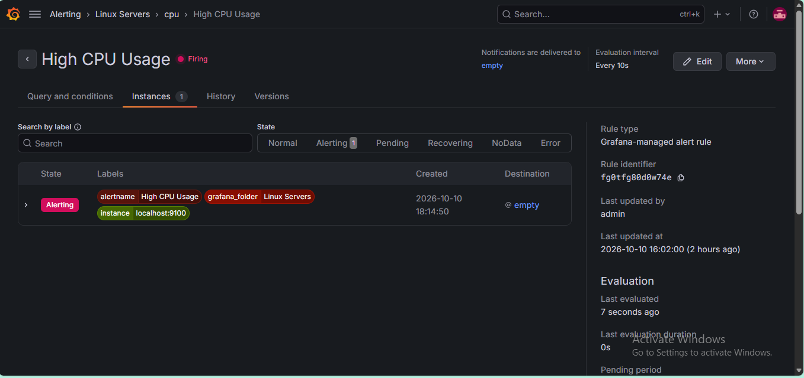

The firing instance carries its identifying labels: `alertname=High CPU Usage`, `grafana_folder=Linux Servers`, `instance=localhost:9100`. In a production setup those labels are what route the notification to the right team.

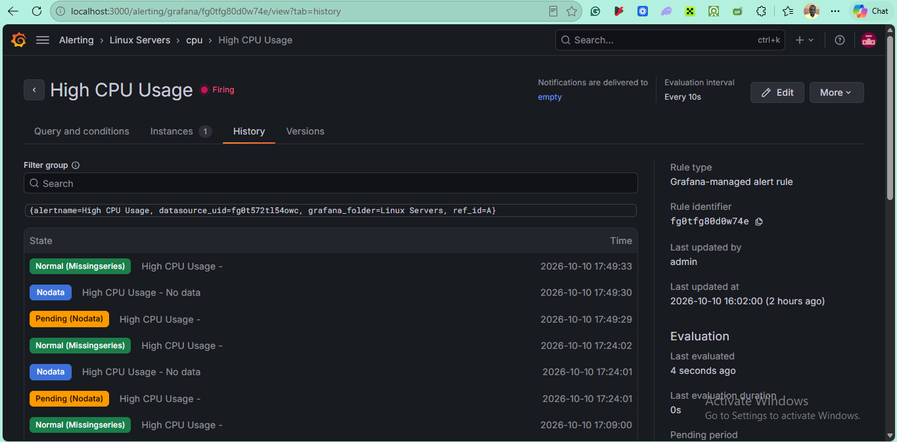

> **Note on the state history.** This view also records `Nodata` and `Normal (MissingSeries)` transitions. Those are not false alarms from the load test. They occurred when the host starved the VM badly enough that Prometheus missed scrapes, leaving the alert query with no series to evaluate. The genuine `Firing` state is evidenced by the two screenshots above it. This is an honest artefact of the environment, explained in the next section.

### Step 5: Identify the cause

```bash
top -b -n 1 | head -15
```

The cause is unambiguous from the process table in step 2: two `stress` processes, owned by `vagrant`, consuming all available CPU. In a real incident this is the pivot point, where the process name, PID and owner tell you whether you are looking at a runaway deployment, a stuck cron job, or legitimate traffic.

### Step 6: Restore normal operation

```bash
pkill stress
```

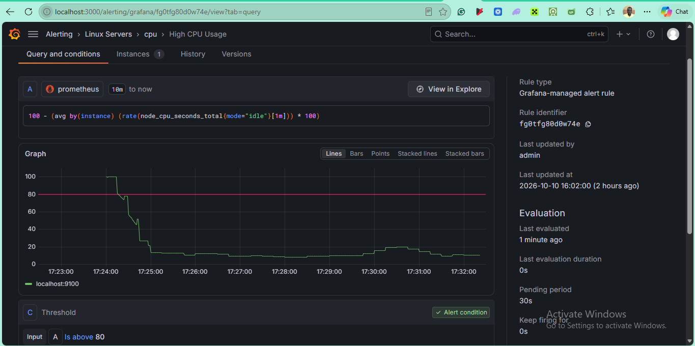

CPU falls from 100% back to the low teens, the series drops below the threshold line, and the rule returns to `Normal` without any manual intervention. A complete detect, investigate, resolve, recover cycle.

---

## 10. Troubleshooting Summary

Building this stack surfaced several genuine failures. They are documented because the diagnosis is the real learning, and because a monitoring exercise that hides its own incidents is not being honest about observability.

| # | Issue | Diagnosis | Resolution |
|---|---|---|---|
| 1 | `vagrant reload` aborted with a boot timeout, then SSH timed out | The VM was booting correctly but needed roughly 13 minutes on a heavily contended host, longer than Vagrant's default wait | Set `config.vm.boot_timeout = 900` in the `Vagrantfile` |
| 2 | Docker, Jenkins and HashiCorp APT sources silently disabled | The Ubuntu release upgrade moved third party source files aside, as it does by design for repositories it cannot map to the new release | Recreated each source for the new release codename using `signed-by` keyrings, then upgraded Docker |
| 3 | Minikube cluster stopped and failed to restart | The API server was slow to report healthy while the VM was still recovering from CPU starvation | Started with `--wait-timeout=20m`; the cluster came up and was verified with `kubectl get nodes` |
| 4 | Verification command returned nothing | The Prometheus job was named `node`, while the verification step greps for `node_exporter` | Renamed the job in `prometheus.yml`, validated with `promtool`, restarted Prometheus |
| 5 | Load tests produced unusable evidence: a 60 second `stress` run reported completing in **252 seconds** | Host level CPU starvation of the guest. Load average reached 15.39 while the guest CPU reported 86.4% idle, and the kernel logged `rcu_preempt kthread` stall warnings | Switched to a long running load and captured evidence while it was still live; reduced the VM to `vb.cpus = 1` |

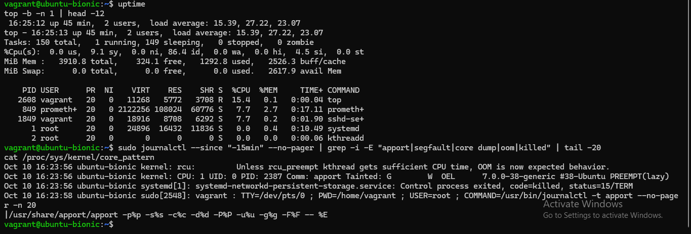

Issue 5 is the most instructive. The guest reported `0.0 us, 9.1 sy, 86.4 id` while carrying a load average of 15.39. A load average of 15 on an idle CPU is a contradiction on bare metal. Inside a VM it is the signature of the hypervisor not scheduling the guest: processes are runnable but never get CPU, so they queue up without ever consuming cycles the guest can observe. The kernel's own RCU stall warning spells it out:

```
rcu: Unless rcu_preempt kthread gets sufficient CPU time, OOM is now expected behavior.
```

Dropping the guest from 2 vCPUs to 1 reduced the scheduling pressure on the host and stabilised the environment.

---

## Key Takeaways

1. **Metrics only show what the guest can see.** When the hypervisor starves a VM, wall clock time and CPU percentages both lie. Cross checking metrics against kernel logs is what exposed the real cause in issue 5.
2. **A load average that contradicts CPU idle is a scheduling problem, not a CPU problem.** The two numbers measure different things: one counts runnable tasks, the other counts consumed cycles.
3. **Pending periods are what make alerts trustworthy.** An alert with no pending period is a noise generator, and a noisy alert is one that gets muted.
4. **Validate configuration before restarting a collector.** `promtool check config` costs one second. A failed Prometheus restart costs a permanent gap in the time series.
5. **Name things so they explain themselves.** Renaming the job from `node` to `node_exporter` cost nothing and made the targets API, the dashboard variables and the alert labels all self describing.

---

## Roadmap

- ✅ **Phase 1**: Provision the Ubuntu VM with Vagrant, forward all stack ports
- ✅ **Phase 2**: Install Prometheus, configure scrape jobs, verify targets with the API
- ✅ **Phase 3**: Install Node Exporter, confirm host metrics are being collected
- ✅ **Phase 4**: Install Grafana, add the Prometheus data source, import dashboard 1860
- ✅ **Phase 5**: Monitor CPU, memory, disk and uptime through PromQL
- ✅ **Phase 6**: Explore Linux log files and the systemd journal
- ✅ **Phase 7**: Configure the High CPU Usage alert rule with a pending period
- ✅ **Phase 8**: Run a controlled load test and document the full incident cycle
- ✅ **Phase 9**: Produce the written report with captioned evidence
- ⬜ **Phase 10**: Deploy the ELK stack and correlate log events against metric spikes
- ⬜ **Phase 11**: Add Alertmanager with email or Slack notification routing
- ⬜ **Phase 12**: Convert the stack to Infrastructure as Code with Ansible provisioning

---

## Reproducing This Lab

```bash
# 1. Clone and bring up the VM
git clone https://github.com/ooseni/davine-week8-Monitoring-Logging-Observability.git
cd davine-week8-Monitoring-Logging-Observability
vagrant up
vagrant ssh

# 2. Install the stack inside the VM
sudo apt-get update
sudo apt-get install -y prometheus prometheus-node-exporter stress

# 3. Apply the scrape configuration (copy config/prometheus.yml into the VM first)
sudo cp /vagrant/config/prometheus.yml /etc/prometheus/prometheus.yml
promtool check config /etc/prometheus/prometheus.yml
sudo systemctl restart prometheus

# 4. Install Grafana (see section 4 for the full repository setup)
sudo systemctl enable --now grafana-server

# 5. Verify everything is collecting
curl -s http://localhost:9090/api/v1/targets | grep -o '"health":"[^"]*"'
curl -s http://localhost:3000/api/health
```

Then open `http://localhost:3000` from the host browser, add the Prometheus data source, import dashboard **1860**, and recreate the alert rule following [`config/alert-rules/high-cpu-usage.md`](./config/alert-rules/high-cpu-usage.md).

---

## Report

The full written report, with all fourteen captioned figures, is in [`docs/Week8-Monitoring-Logging-Observability-Report.pdf`](./docs/Week8-Monitoring-Logging-Observability-Report.pdf).

---

## Author

**Oseni Sakariyau Oluwadamilare (Dami)**
DevOps Engineering Intern @ Davine Technologies

---

## License

Released under the [MIT License](LICENSE).
